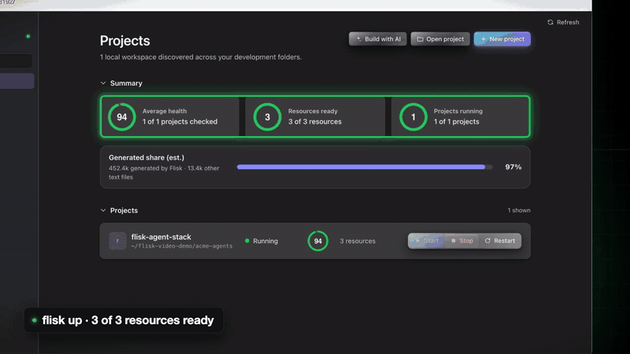

# FliskOS

FliskOS is one local window for everything Flisk: your projects and their stacks, the coding agents that work on them, and the other Flisk apps. It runs on your machine, binds only to `127.0.0.1`, and holds no keys or accounts.

- **Projects.** Project, stack and resource health, recent logs, endpoints and configured port conflicts. Start, stop or restart a project, stack or resource, and open its folder or a terminal.
- **Agents.** Run Claude Code, Codex, Cursor Agent, Grok Build or fx inside a project, follow what they do, and reply in the same thread, the way [T3 Code](https://github.com/pingdotgg/t3code) does. Each agent runs on the login you already have for it.
- **Apps.** Pages, Citable, Helpdock, Command Comparer, the DevEx Roadmap and Demos, each pointed at the project you pick.



A silent 10-second loop. Every screen is a real capture of FliskOS running a demo agent stack (`flisk project agent-stack`, then `flisk up agents`).

> Renamed from Flisk App (and TDK App before that). The macOS bundle is now `FliskOS.app`, the npm package `@flisk-sh/fliskos` and the command `fliskos` (`flisk-app` still works). The installer removes the old `Flisk App.app` and `TDK App.app`, and the old state file is read once so pins, hidden projects and known roots survive.

## Projects

FliskOS uses the installed Flisk CLI for status and lifecycle operations. It does not connect to a hosted control plane. Start runs `flisk up` (optionally for one stack or resources). Stop runs `flisk down` and Restart runs `flisk down` then `flisk up`; both act on the whole project because `flisk down` has no scope. On load FliskOS runs non-mutating probes (`flisk --version`, `flisk up --help`, `flisk down --help`). If the CLI is older, missing, or not responding, lifecycle controls are disabled with an explanation, `POST /api/actions` returns HTTP 409 (`cli_unsupported`) without running anything, and status, endpoints, ports, logs, and folder/terminal actions keep working.

The CLI is found by name, not by a hardcoded command: FliskOS looks for `flisk` first and still accepts the legacy `tdk` name from older installs. It also matches the CLI's own usage output, so a renamed binary (or a command alias such as `up|deploy`) is detected correctly.

Recent logs, failed config runs and doctor issues can have **Inspect with** links (Grok, Claude, Codex) that open the chat with that output already in the prompt. The links are off by default: turn on **Inspect with AI** in the Recent logs dialog to show them. Secret-looking values are redacted and long output is trimmed, and nothing is sent until you click one of the links.

## Agents

**Agents** lists the coding agents installed on this machine and the threads you started. A thread belongs to one project and one agent: FliskOS runs the agent in the project folder, one process per message, and keeps the agent's session so a reply continues the same conversation.

| Agent | How FliskOS runs it | Read only | Edit files |
| --- | --- | --- | --- |
| Claude Code | `claude -p --output-format stream-json` | `--permission-mode plan` | `--permission-mode acceptEdits`; shell commands run only if your Claude Code settings allow them |
| Codex | `codex exec --experimental-json` | `--sandbox read-only` | `--sandbox workspace-write`: edits and sandboxed commands, no network |
| Cursor Agent | `cursor-agent -p --output-format stream-json` | `--mode plan` | edits; shell commands run only if your Cursor settings allow them |
| Grok Build | `grok agent stdio` (ACP) | every edit or command it asks for is refused | file edits it asks for are allowed, commands are refused |
| fx | `fx acp` (ACP) | the same as Grok | the same as Grok |

Grok and fx speak the [Agent Client Protocol](https://agentclientprotocol.com). FliskOS answers their permission requests by the thread's mode with `allow_once` or `reject_once`, never `allow_always`, so nothing is written into the agent's own settings. It offers them no file system or terminal of its own.

- **Your logins, your keys.** FliskOS never asks for an API key. An agent that is not signed in fails its first message with its own error and the command to fix it (for example `grok login`); run it once in a terminal.
- **Stack status.** The first message of a thread can carry a short summary of the project's stack (resources, status, URLs, and the `flisk` commands to inspect it). It goes to the agent after your words and is not shown as part of your message.
- **Ask an agent.** The project header and the Recent logs dialog have **Ask an agent**, which opens a new thread for that project; from the logs it starts with the same redacted prompt the Inspect links use.
- **Threads are kept** next to the state file (`threads/` in the FliskOS state folder), so they survive a restart; a message that was still running when FliskOS quit shows as interrupted. Up to four agents work at once. Deleting a thread removes FliskOS's copy only, not the agent's own session history.

Claude Code and Codex read the prompt on stdin, Cursor Agent gets it as one argument, and Grok and fx get it in an ACP message; it never goes through a shell.

## Apps

**Apps** shows the other Flisk tools with actions for the selected project. Links open in your browser and commands are copied, never run.

- **Pages** ([pages.flisk.si](https://pages.flisk.si)): start an agent thread that builds a one-page explainer of the stack, and copy the command that publishes it.
- **Citable** ([citable.flisk.si](https://citable.flisk.si)): copy `npx @flisk-sh/citable <url>` for each running frontend.
- **Helpdock** ([helpdock.flisk.sh](https://helpdock.flisk.sh)): open the help center for the project's GitHub repository (read from its `origin` remote) and copy its MCP URL.
- **Command Comparer**, **DevEx Roadmap** and **Demos**: open the site.

## Screenshots

**Overview** (dark): health, readiness and running gauges, plus every project with Start, Stop and Restart.


**Project** (dark): stacks and resources with inline actions, doctor score, and a more-actions menu.


**Project** (light): the same view in light mode.


Screenshots are produced by the app itself: `FLISK_SNAPSHOT=out.png FLISK_APPEARANCE=dark "dist/FliskOS.app/Contents/MacOS/FliskOS"` renders the window to a PNG and exits (`FLISK_SNAPSHOT_JS` runs a script first, for example to open a project). Account names are masked in the UI, so paths appear as `~/...`.

## Install the Flisk CLI

FliskOS drives the Flisk CLI, so install it first. The install script never runs `sudo` and writes to `/usr/local/bin` when that is writable, otherwise to `~/.local/bin`:

```sh
curl -fsSL https://flisk.sh/install.sh | sh
```

To update an existing install, run the same command again, or use the CLI's own updater:

```sh
flisk upgrade --yes
```

## Run from a checkout

Requires Node.js 22.12 or newer, or Bun, and the Flisk CLI on `PATH`.

```sh
npm start
npm start -- --project ~/src/storefront --project ~/src/billing
npm start -- --scan-root ~/workspaces
npm start -- --no-scan --project ~/src/storefront
npm start -- --port 43120
bun src/cli.js          # the same server under Bun (npm run start:bun)
```

FliskOS automatically searches common development locations, including `/var/www`, `~/ollama`, `~/Codex`, `~/Documents/Codex`, `~/GitHub`, `~/Documents/GitHub`, `~/src`, `~/Projects`, and `~/Developer`. It also includes the project containing the current directory. Scans are bounded to eight directory levels and skip dependency, build, and version-control folders. Use repeatable `--scan-root` options to add locations, `--project` to add a specific project root, or `--no-scan` to scan only what the command line names (no common folders, saved scan folders or known projects). Every selected project must contain `.flisk/project.json` (projects made before the CLI rename have `.tdk/project.json`, which is still found).

**Open project** takes either one project or a folder of projects (such as `~/code`). A folder of projects is saved as a scan folder and scanned again at every start, so new projects in it show up by themselves; this is how the macOS app, which takes no options, learns about folders outside the common ones. The overview lists the saved folders with **Stop** next to each; stopping keeps the projects already in the list. Up to 20 folders can be saved.

`--port 0` (the default) selects an available local port.

The server binds only to `127.0.0.1`, protects the browser session with a random in-memory token, and exits with the app process. Closing the dashboard does not stop project resources; quitting FliskOS stops any agent that is still working. The terminal dashboard `flisk ui` remains available independently.

The state file is `~/Library/Application Support/FliskOS/state.json` on macOS and `~/.config/fliskos/state.json` elsewhere; set `FLISKOS_STATE` to use another path (`FLISK_APP_STATE` and `TDK_APP_STATE` still work).

## macOS app

A lightweight native app (about 1 MB, most of it the icon; a WKWebView shell, no Electron) that runs the same server in its own window:

```sh
npm run install:mac     # builds, then installs FliskOS into /Applications (or ~/Applications)
open -a FliskOS
```

The installer needs no sudo. It copies the app, registers it with Launch Services so it appears in Launchpad and Spotlight, and replaces any previous copy. To build without installing, run `npm run build:mac` and open `dist/FliskOS.app`. The icon is generated by `macos/make-icon.swift`; the result is committed as `macos/AppIcon.icns`.

Requires Xcode Command Line Tools to build, and Node.js 22.12+ or Bun on your login-shell `PATH` to run (Node is used when both are installed). The app starts the server with `--no-open` and stops it when you quit.

## Install as a command

After a package release, install the published package globally and run:

```sh
npm install --global @flisk-sh/fliskos
fliskos
```

The package is not published yet; use the checkout instructions above until a release is available.

The source lives at [flisk-sh/fliskos](https://github.com/flisk-sh/fliskos) (it was `flisk-sh/flisk-app`, and `flisk-sh/tdk-app` before that; GitHub redirects the old URLs).

## Development

```sh
npm test            # or: bun test test/
```

The agent tests run the real Claude Code, Codex and ACP adapters against two fake agents in `test/fixtures/` (a stream-json agent and an ACP agent) and a recorded Claude Code turn, so they need no agent installed and no login.

The accessibility checks run separately in Chromium:

```sh
npm install
npx playwright install chromium
npm run test:browser
```

They cover the sidebar toggle state and dialog names. They use a local fixture server and do not start Flisk projects or open external apps.

The server uses Node.js built-ins only. FliskOS discovers the CLI on `PATH` as `flisk` (preferred) or the legacy `tdk`. Set `FLISK_BIN` (or `TDK_BIN`) to the path of a CLI executable when it is installed under another name or is not on `PATH`.
